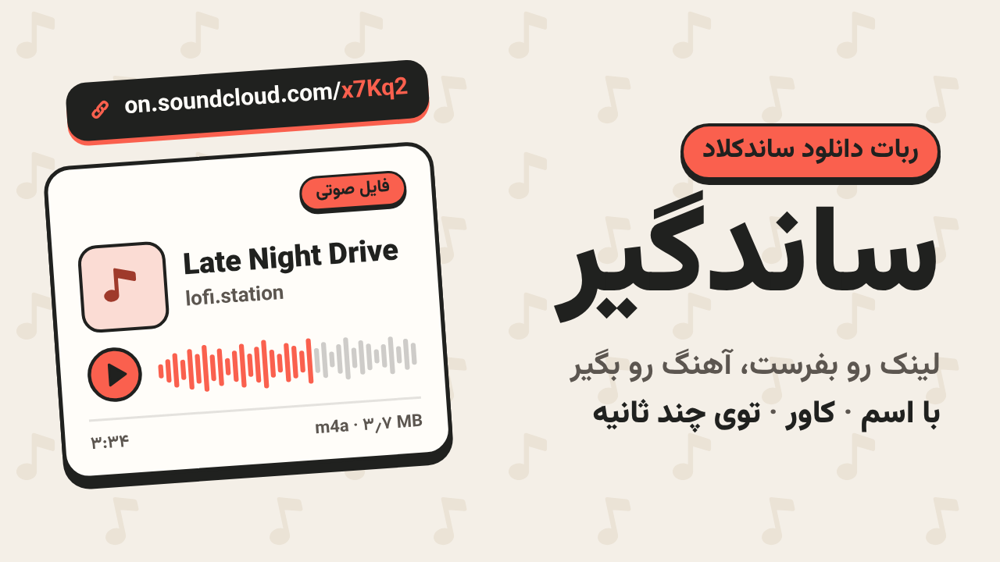

# دانلودر ساندکلاد تلگرام



<div dir="rtl">

رباتی روی **Telegram Serverless (tgcloud)** که لینک هر ترک ساندکلاد را بگیرد، فایل صوتی‌اش را با اسم، خواننده و کاور در همان چت می‌فرستد. سرور ندارد: کدش ماژول‌های جاوااسکریپتی است که خود تلگرام اجرا می‌کند. معماری، تست‌ها و دیپلوی همان الگوی [inline-calculator-telegram](https://github.com/IsAmirMmd/inline-calculator-telegram) است که از [tgcloud-kit](https://github.com/IsAmirMmd/serverless-tg-bot) آمده.

> **وضعیت:** روی ربات `app8916613120` دیپلوی شده. بررسی از سرور تلگرام (`endpoints/adminProbe`) جواب داد و اولین لینک واقعی (`on.soundcloud.com/…`) در ۲٫۸ ثانیه به فایل صوتی AAC 160k (۳٫۷ مگابایت) تبدیل و فرستاده شد.

## استفاده

لینک ترک را در پی‌وی ربات بفرستید:

</div>

```
https://soundcloud.com/forss/flickermood
https://on.soundcloud.com/AbCd123
```

<div dir="rtl">

1. ربات فوراً با «⏳ دارم از ساندکلاد می‌گیرمش…» جواب می‌دهد.
2. چند ثانیه بعد فایل صوتی می‌رسد: اسم فایل `Artist - Title.m4a` (یا `.mp3` برای ترک‌هایی که ساندکلاد هنوز به AAC نبرده)، با کاور ترک و لینکش به ساندکلاد در کپشن.
3. اگر نشود، همان پیام «⏳» به دلیلش تبدیل می‌شود (پیدا نشد، فقط پیش‌نمایش Go+، رمزگذاری‌شده، خیلی طولانی و …).

### عوض کردن اسم، خواننده و کاور

زیر هر فایل صوتی سه دکمه هست:

| دکمه | چه می‌پرسد |
|---|---|
| **✏️ اسم آهنگ** | اسم جدید (متن) |
| **🎤 خواننده** | اسم جدید خواننده (متن) |
| **🖼 کاور** | عکس جدید (به‌صورت عکس، نه فایل) |

- دکمه را بزنید، ربات می‌پرسد (با دکمه‌ی **❌ انصراف**)، جواب را بفرستید. یک نسخه‌ی تازه از همان آهنگ با اطلاعات جدید می‌رسد، با همان سه دکمه، پس می‌شود پشت سر هم چند چیز را عوض کرد.
- تلگرام اطلاعات یک فایل صوتی را با خود فایل نگه می‌دارد، پس برای عوض کردنش فایل دوباره آپلود می‌شود: ربات آن را از تلگرام پس می‌گیرد (تا ۲۰ مگابایت) یا برای فایل بزرگ‌تر دوباره از ساندکلاد دانلود می‌کند.
- اسم، خواننده و کاور **داخل خود فایل** هم نوشته می‌شوند (ID3 برای MP3، تگ‌های iTunes برای M4A)، پس بعد از ذخیره در گوشی هم همین‌ها دیده می‌شوند. صدای فایل دست نمی‌خورد.
- اگر وسط سؤال یک لینک ساندکلاد بفرستید، ربات آن را دانلود می‌کند و سؤال کنار می‌رود.

| لینک | |
|---|---|
| `soundcloud.com/<artist>/<track>` (با `www.` یا `m.`، با یا بدون `https://`) | ✅ |
| لینک اشتراک‌گذاری اپ: `on.soundcloud.com/…` | ✅ |
| ترک خصوصی با لینک مخفی‌اش (`…/s-xxxx`) | ✅ |
| پلی‌لیست، آلبوم، پروفایل | ❌ فعلاً (در نقشه‌ی راه) |
| لینک در گروه | ❌ فعلاً فقط پی‌وی |

- هر ترک فقط بار اول دانلود می‌شود. `file_id` فایلش در جدول `tracks` می‌ماند و درخواست بعدی، از هر کسی، بلافاصله با همان فرستاده می‌شود.
- **محدودیت‌ها:** تلگرام از ربات فایل بزرگ‌تر از ۵۰ مگابایت قبول نمی‌کند، پس ترک‌های بلندتر از ۵۰ دقیقه قبل از دانلود رد می‌شوند. ترک‌های SoundCloud Go+ فقط پیش‌نمایش ۳۰ ثانیه‌ای عمومی دارند و ترک‌هایی که فقط به‌صورت رمزگذاری‌شده (DRM) پخش می‌شوند قابل دانلود نیستند.

## چطور کار می‌کند

ساندکلاد دیگر برای اپ جدید کلید API نمی‌دهد. ربات مثل پخش‌کننده‌ی خود سایت با `api-v2.soundcloud.com` کار می‌کند و `client_id` عمومی سایت را از صفحه‌ی soundcloud.com برمی‌دارد، در جدول `settings` نگه می‌دارد و هر وقت رد شد (401/403) دوباره برمی‌دارد. بعد:

</div>

```
لینک → resolve → بهترین استریم: MP3 (اگر هنوز باشد) › AAC 160k › AAC 96k
     → دانلود قطعه‌های HLS (چهارتا چهارتا، به ترتیب) → sendAudio با کاور → file_id در tracks
```

<div dir="rtl">

جزئیات کامل (فرمت‌ها، محدودیت‌ها، کد خطاها، ریسک‌ها و نقشه‌ی راه) در [`docs/SOUNDCLOUD.md`](docs/SOUNDCLOUD.md) است.

## دستورهای ادمین

ادمین `199419831` است (`ADMIN_ID` در `tgcloud/lib/config.js`). این دستورها با زدن `/` فقط در چت ادمین پیشنهاد می‌شوند:

| دستور | کار |
|---|---|
| `/stats` | کاربران، لینک‌ها، دانلودها، ارسال از کش، خطاها به تفکیک دلیل |
| `/sc [لینک]` | بررسی قدم‌به‌قدم ساندکلاد از سرور تلگرام: client_id، resolve، فرمت‌ها، دانلود (بدون ارسال) |
| `/setclientid <id>` | تنظیم دستی client_id ساندکلاد، اگر برداشتنش از سایت خراب شد |
| `/backup` | جدول‌های `users`، `tracks` و `downloads` به‌صورت CSV (هر ۸ ساعت هم خودکار) |
| `/ping` | تست زنده بودن ربات |
| `/setcommands` | به‌روزرسانی دستی لیست دستورهای `/` (هر دیپلوی و `/start` ادمین خودشان این کار را می‌کنند) |

## راه‌اندازی

۱. در **BotFather** ربات را بسازید. اسم، بیو، توضیح، عکس پروفایل و بنر: [`branding/BOTFATHER.md`](branding/BOTFATHER.md).

۲. نصب و تست آفلاین (Node 22.12 یا بالاتر):

</div>

```
npm install
npm test
```

<div dir="rtl">

۳. اتصال به ربات با `npx tgcloud login` (توکن: BotFather ← ربات ← Serverless ← CLI Access ← Access token). توکن را در چت یا کد نگذارید.

۴. سکرت `TGCLOUD_TOKEN` را با همان توکن در تنظیمات ریپو در GitHub اضافه کنید. از آن به بعد هر push به `main` دیپلوی می‌شود. بار اول می‌شود دستی هم دیپلوی کرد:

</div>

```
npm run deploy
npx tgcloud migrate
```

<div dir="rtl">

۵. ادمین یک بار `/start` را به ربات می‌فرستد (لیست دستورهای ادمین فقط بعد از اولین `/start` او قابل تنظیم است) و بعد `/sc`.

### بررسی از سرور تلگرام

`npm test` روی یک ساندکلاد شبیه‌سازی‌شده اجرا می‌شود و چیزی درباره‌ی ساندکلاد واقعی نمی‌گوید. اینکه ساندکلاد از سرورهای تلگرام جواب می‌دهد، چه فرمت‌هایی می‌دهد و هر قدم چقدر طول می‌کشد را فقط خود سرور می‌تواند بگوید:

- در ربات: `/sc` یا `/sc <لینک>`
- در GitHub: Actions ← Run in cloud ← `endpoints/adminProbe` با `{}` یا `{ url: "…" }`
- `check.yml` روی هر برنچی غیر از `main` همین را خودکار اجرا می‌کند.

## توسعه و دیپلوی

- **روی `main` کار می‌شود** (یک نفر توسعه می‌دهد) و هر push به `main` دیپلوی می‌شود. `deploy.yml` به این ترتیب کار می‌کند:
  1. تست‌ها (`npm test`). اگر رد شوند چیزی دیپلوی نمی‌شود.
  2. `tgcloud push` (اگر CLI بعد از آپلود موفق کرش کند، یک بار دیگر fetch و push می‌کند).
  3. `migrate --safe`، `webhook sync` و تنظیم لیست دستورهای `/`.
- **`check.yml`:** روی برنچ‌های دیگر و pull requestها تست‌ها را اجرا می‌کند و بعد `endpoints/adminProbe` را **بدون دیپلوی** در سرور تلگرام اجرا می‌کند.
- **`run.yml` (Run in cloud):** یک ماژول را به‌عنوان ادمین و بدون دیپلوی در سرور اجرا می‌کند، مثلاً:
  - `endpoints/adminProbe` با `{ url: "https://soundcloud.com/…" }`
  - `endpoints/sql` با `{ q: "SELECT status, error, count(*) AS n FROM downloads GROUP BY 1, 2" }`
- **`scheduled.yml`:** هر ۸ ساعت `/backup` را اجرا می‌کند.
- از ترمینال: `npm run sql -- "SELECT * FROM downloads ORDER BY id DESC LIMIT 10"`.
- قراردادهای پروژه در [`docs/ARCHITECTURE.md`](docs/ARCHITECTURE.md) و نحوه‌ی کار در [`CLAUDE.md`](CLAUDE.md) است.

## اسکیل‌ها (Claude Code)

این ریپو سه اسکیل مخصوص خودش دارد که Claude Code موقع کار روی همین پروژه خودکار می‌خواند (`.claude/skills/`):

| اسکیل | کارش |
|---|---|
| **bot-feature** | روال اضافه کردن یا تغییر یک قابلیت در همین ریپو: schema ← lib ← handler ← تست ← بررسی در سرور ← push به main و چک کردن دیپلوی |
| **soundcloud-api** | ساندکلاد از دید ربات: client_id، resolve، فرمت‌های استریم، HLS، policyها، کد خطاها و نحوه‌ی امتحان در سرور |
| **telegram-audio** | سمت تلگرام: `sendAudio`، کش `file_id`، کاور، محدودیت‌های حجم، پیام وضعیت و خطاهای Bot API |

`.claude/settings.json` هم افزونه‌ی [tgcloud-kit](https://github.com/IsAmirMmd/serverless-tg-bot) را فعال می‌کند (اسکیل‌های tgcloud-bot، tgcloud-endpoints، tgcloud-growth، tgcloud-mini-app و mirza-design-system).

## ساختار

</div>

```
tgcloud/
  handlers/message.js               ← /start، /help، دستورهای ادمین، لینک ساندکلاد → دانلود
  handlers/callback_query.js        ← دکمه‌ها: منو، ارسال نظر
  handlers/my_chat_member.js        ← بلاک و آنبلاک شدن ربات
  endpoints/adminProbe.js           ← (ادمین) بررسی قدم‌به‌قدم ساندکلاد از سرور
  endpoints/adminSyncCommands.js    ← (ادمین) تنظیم لیست دستورهای /؛ بعد از هر دیپلوی
  endpoints/me.js, endpoints/sql.js ← چه کسی صدا می‌زند؛ SQL ادمین برای npm run sql
  lib/soundcloud.js                 ← api-v2: لینک‌ها، client_id، resolve، انتخاب استریم، دانلود، کاور
  lib/download.js                   ← لینک ← پیام وضعیت ← فایل صوتی؛ کش file_id، لاگ downloads، آمار
  lib/audio.js                      ← فرستادن هر فایل صوتی با کپشن و دکمه‌های ✏️ 🎤 🖼، و ردیفش در sent_audios
  lib/metadata.js                   ← ✏️ 🎤 🖼: پرسیدن، گرفتن جواب، فرستادن نسخه‌ی جدید
  lib/tags.js                       ← نوشتن اسم، خواننده و کاور داخل فایل (ID3 و iTunes ilst)، بدون کتابخانه
  lib/probe.js                      ← /sc و adminProbe
  lib/menu.js, lib/bot.js           ← صفحه‌های خانه و راهنما؛ یوزرنیم ربات
  lib/admin.js, lib/users.js, …     ← دستورهای ادمین، کاربران، تنظیمات و بقیه‌ی پایه‌ی tgcloud-kit
  lib/config.js                     ← ADMIN_ID، محدودیت حجم و مدت، ترک پیش‌فرض /sc
  schema.js                         ← settings، users، tracks (کش file_id)، downloads (لاگ)
test/                               ← soundcloud / download / metadata / tags / commands / bot، روی SDK و ساندکلاد شبیه‌سازی‌شده
scripts/sql.mjs                     ← npm run sql
scripts/render-branding.mjs         ← ساخت عکس پروفایل و بنر از branding/*.html (Playwright)
branding/                           ← BOTFATHER.md (اسم، بیو، توضیح)، avatar/banner به‌صورت HTML و PNG
assets/fonts/                       ← وزیرمتن (SIL OFL)، برای عکس‌های برندینگ
docs/                               ← ARCHITECTURE.md، SOUNDCLOUD.md، tgcloud-sdk.md
.claude/skills/                     ← bot-feature، soundcloud-api، telegram-audio
.github/workflows/                  ← deploy، check، run (Run in cloud)، scheduled
```

<div dir="rtl">

## نقشه‌ی راه

به ترتیب تقریبی (جزئیات: [`docs/SOUNDCLOUD.md`](docs/SOUNDCLOUD.md#7-roadmap)):

1. دیپلوی اول و `/sc`: دسترسی، فرمت‌ها و زمان‌ها از سرور تلگرام؛ تنظیم محدودیت‌ها بر اساس آن.
2. پلی‌لیست و آلبوم.
3. سقف دانلود برای هر کاربر.
4. حالت اینلاین (`@bot <جستجو>`) با ترک‌هایی که قبلاً روی تلگرام هستند.
5. گروه‌ها (وقتی ربات منشن شود).
6. انتخاب کیفیت و فرمت.

## توسعه‌دهنده

توسعه‌دهنده‌ی اصلی: [@isAmirMmd](https://t.me/isAmirMmd) (تلگرام) · [IsAmirMmd](https://github.com/IsAmirMmd) (گیت‌هاب)

</div>
